<a id="readme-top"></a>

<div align="center">


<br/>

[](LICENSE)
[](#requirements)
[](#requirements)
[](#built-with)
[](#data-model)
[](#testing)
[](#testing)
<!-- After your workflow runs once, enable this badge (change ci.yml to your workflow file name):
[](https://github.com/ChornChhery/Production-Plan/actions/workflows/ci.yml) -->
[](https://github.com/ChornChhery/Production-Plan/stargazers)
[](https://github.com/ChornChhery/Production-Plan/issues)
[](https://github.com/ChornChhery/Production-Plan/commits)
[](https://github.com/ChornChhery/Production-Plan/releases)
[](#contributing)

**Count what goes IN and what comes OUT of a production line, compare it with the plan on a big screen, and keep an Excel log of every shift.**
Two laptops, two USB-Ethernet adapters, one cable. No router, no internet, no server.

[Quick start](#quick-start) ·
[How it works](#how-it-works) ·
[Diagrams](#architecture-and-diagrams) ·
[Documentation](#documentation) ·
[Report a bug](https://github.com/ChornChhery/Production-Plan/issues/new/choose) ·
[Request a feature](https://github.com/ChornChhery/Production-Plan/issues/new/choose)

[**⬇️ Download the latest release**](https://github.com/ChornChhery/Production-Plan/releases/latest) · [**⭐ Star this repository**](https://github.com/ChornChhery/Production-Plan)

</div>

<details>
<summary><b>Table of contents</b></summary>

1. [About the project](#about-the-project)
2. [See it work](#see-it-work)
3. [Features](#features)
4. [Screenshots](#screenshots)
5. [How it works](#how-it-works)
6. [Architecture and diagrams](#architecture-and-diagrams)
7. [Data model](#data-model)
8. [Requirements](#requirements)
9. [Quick start](#quick-start)
10. [Daily use](#daily-use)
11. [Configuration](#configuration)
12. [Teeth Doctor: the self-repairing setup](#teeth-doctor-the-self-repairing-setup)
13. [Project structure](#project-structure)
14. [Build from source](#build-from-source)
15. [Testing](#testing)
16. [Troubleshooting](#troubleshooting)
17. [FAQ](#faq)
18. [Security](#security)
19. [Project status and limits](#project-status-and-limits)
20. [Roadmap](#roadmap)
21. [Changelog](#changelog)
22. [Documentation](#documentation)
23. [Contributing](#contributing)
24. [License](#license)
25. [Contact and acknowledgments](#contact-and-acknowledgments)

</details>

---

## About the project

On a production line, someone has to know how many parts went **IN** and how many came **OUT**, and whether that is ahead of or behind the plan **right now**. **Teeth** does that with equipment you already have:

- **Laptop 1** counts **IN**: every press of a key button is `+1 IN`.
- **Laptop 2** counts **OUT**: every barcode scan is `+1 OUT`, and it shows a big screen with **Plan / Target / Result / Difference**.
- The two laptops talk over **one Ethernet cable** through two USB-Ethernet adapters, so the existing **print network and label printing are never touched**.
- Every shift ends with a row in an **Excel log**. The counts survive restarts, crashes and power cuts.

> **Why two USB adapters?** Both laptops already use their built-in Ethernet port for the print software. The Teeth link uses a second network port (a USB adapter) with its own private address range, so labels keep printing exactly as before.

<p align="right">(<a href="#readme-top">back to top</a>)</p>

## See it work

<div align="center">
  
  <br/><sub>A key press on laptop 1 becomes <code>IN 4821</code>, laptop 2 counts it and answers <code>OK 4821</code>. A scan on laptop 2 counts OUT.</sub>
</div>

### No lost presses

<div align="center">
  
  <br/><sub>Cable out? Presses wait in <code>pending.txt</code>. Cable back? They are sent one by one and each id is counted exactly once.</sub>
</div>

### Two shifts a day

<div align="center">
  
  <br/><sub>At 08:00 and 20:00 the finished shift is written to Excel and the new one starts at 0.</sub>
</div>

<p align="right">(<a href="#readme-top">back to top</a>)</p>

## Features

| | Feature | Detail |
|---|---|---|
| 🔢 | **IN / OUT counting** | Key button on laptop 1 (`P` + `Enter`), barcode scanner on laptop 2. Manual correction with `Ctrl+Alt+I` / `Ctrl+Alt+O`. |
| 📊 | **Plan, Target, Result, Difference** | Big-screen dashboard. Green when ahead, red when behind. Targets follow the work blocks and breaks of the active schedule. |
| 🌗 | **Automatic shifts** | Day `08:00-20:00` and Night `20:00-08:00`. At a shift change the old shift is written to Excel and the counts start again at 0. |
| 🔌 | **Private link, print network untouched** | TCP port `5055` over a direct cable, addresses `192.168.50.1` and `192.168.50.2`, no gateway. |
| 🛡️ | **No lost presses** | Presses wait in `pending.txt` until laptop 2 answers `OK`. Every press has a unique id, so a re-send is counted only once. |
| 💾 | **Crash-safe** | Counts are saved to SQLite every 3 seconds and restored at start-up. |
| 📗 | **Excel shift log** | `Log Data\Teeth_Log.xlsx`: one row per shift, per manual reset and per mid-shift close. |
| 🩺 | **Teeth Doctor** | One click sets everything up. A hidden task then checks and repairs the link every 5 minutes. |
| 🧰 | **Counts safety net (laptop 2)** | Backs up IN/OUT outside the Teeth folder and restores them in the same shift if the database comes back as 0 / 0, or if Teeth starts with a new empty database. |
| 🔁 | **Sender total kept** | The running total on laptop 1 is kept across restarts of TeethSender. |
| 🔐 | **Configurable admin PIN** | The admin PIN is a setting, not a value built into the program. |
| ✅ | **Continuous integration** | GitHub Actions builds both programs and runs the Doctor test suites on every push. |
| ↩️ | **Undo** | `TEETH-UNDO.bat` removes the task, the firewall rules and the adapter address. Programs and data stay. |

<p align="right">(<a href="#readme-top">back to top</a>)</p>

## Screenshots

<div align="center">

| The big screen (laptop 2) | The sender bar (laptop 1) |
|:---:|:---:|
| 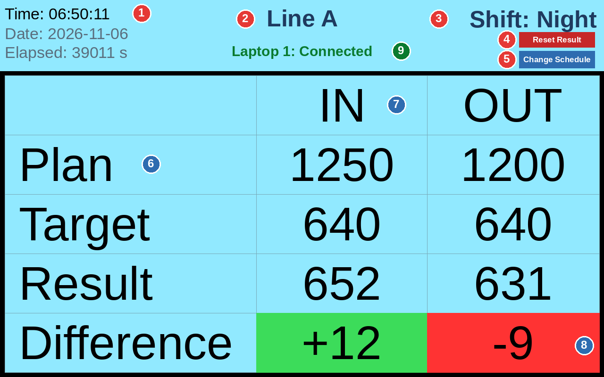 | 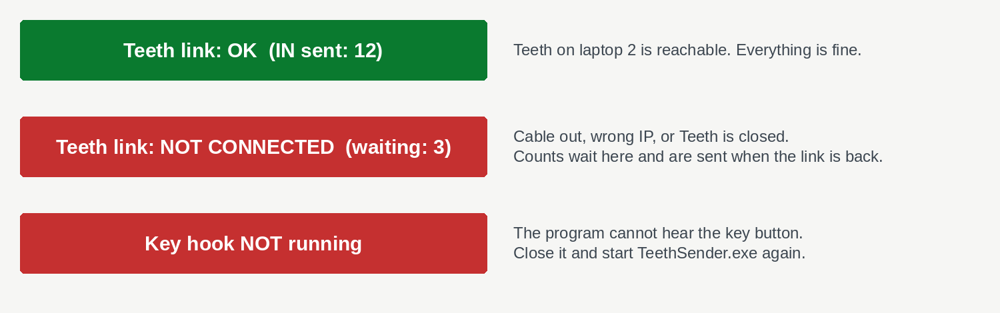 |
| Plan, Target, Result and Difference for IN and OUT. | Link status and a running total of presses since TeethSender started. |

| The whole system | The two USB adapters |
|:---:|:---:|
| 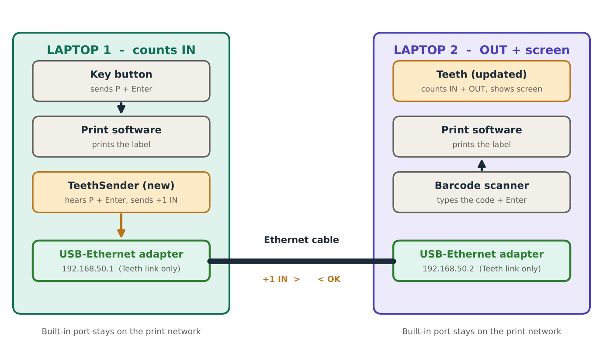 | 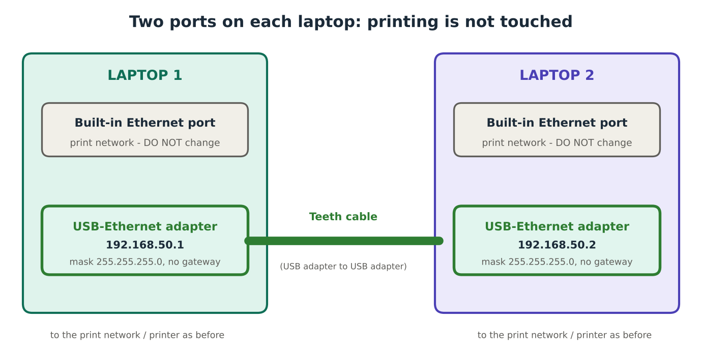 |

<sub>Annotated illustrations of the real screens.</sub>

<!-- Real screenshots and the screen recording: copy your files to assets/images/ and swap the lines above for these:


-->

</div>

<p align="right">(<a href="#readme-top">back to top</a>)</p>

## How it works

1. An operator presses the **key button** on laptop 1. The button sends `P` + `Enter`; **TeethSender** hears it (it only *listens*, the print software still gets the key) and creates a unique id.
2. TeethSender writes the id to `pending.txt` and sends `IN <id>` over TCP port `5055`.
3. **Teeth** on laptop 2 adds `+1` to IN (unless it has already seen that id) and answers `OK <id>`.
4. TeethSender removes the id from `pending.txt`. If no `OK` comes back, the id stays and is sent again later.
5. A **barcode scan** on laptop 2 (4 or more characters, each less than 50 ms apart, then `Enter`) counts `+1 OUT`. Typing by hand is too slow to be mistaken for a scan.
6. Every 3 seconds Teeth saves the counts to SQLite. At each shift change it writes a row to the Excel log and starts again at 0.

<p align="right">(<a href="#readme-top">back to top</a>)</p>

## Architecture and diagrams

### System architecture

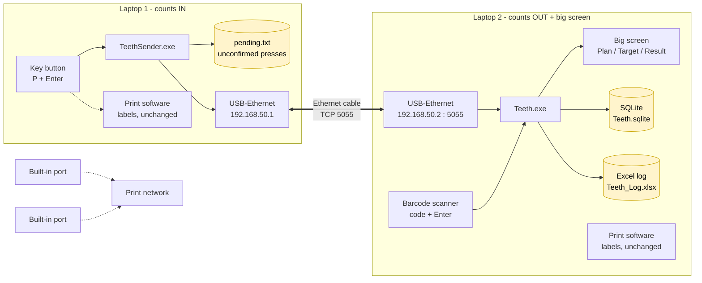

### Message flow (sequence)

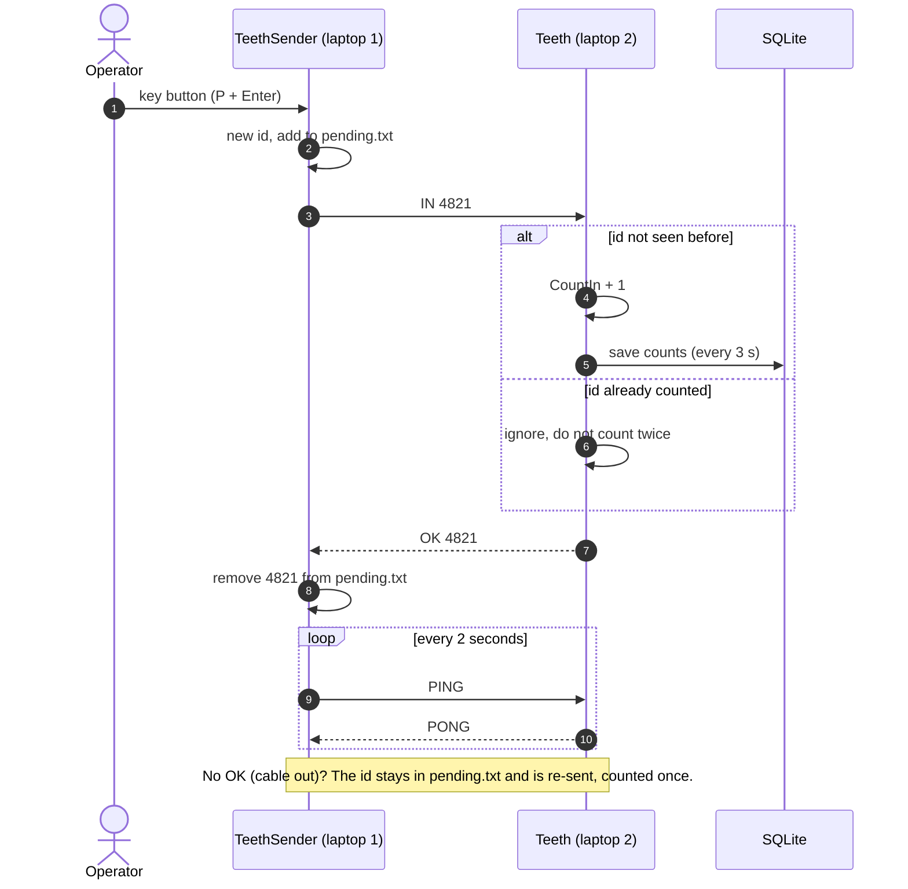

### Shift lifecycle of Teeth

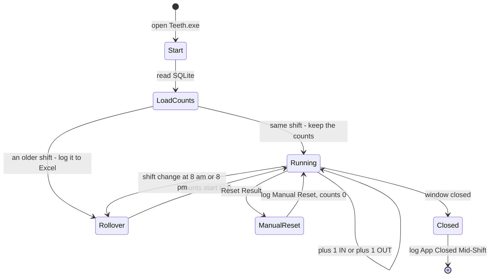

### Setup workflow (one click per laptop)

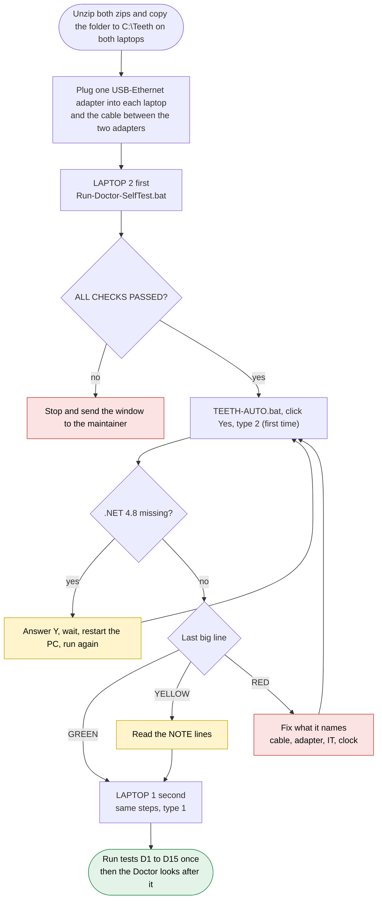

### What the Doctor does on every run

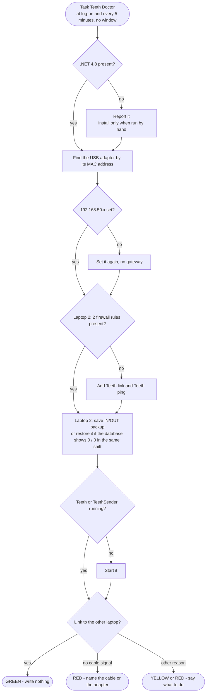

### Counts safety net

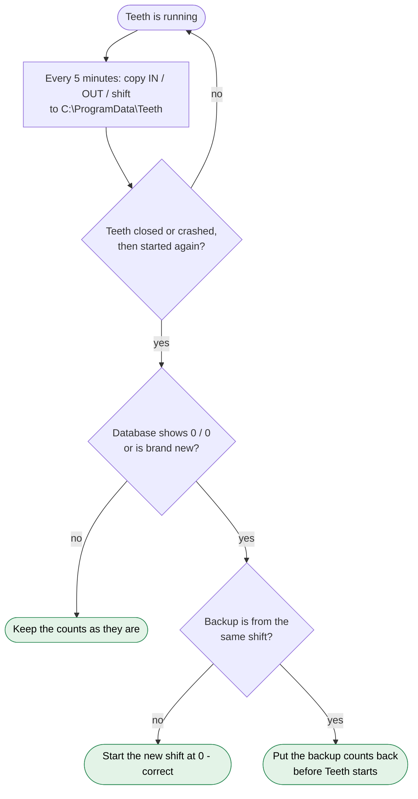

### Continuous integration

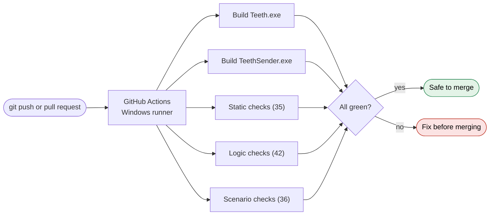

### A day with Teeth (user journey)

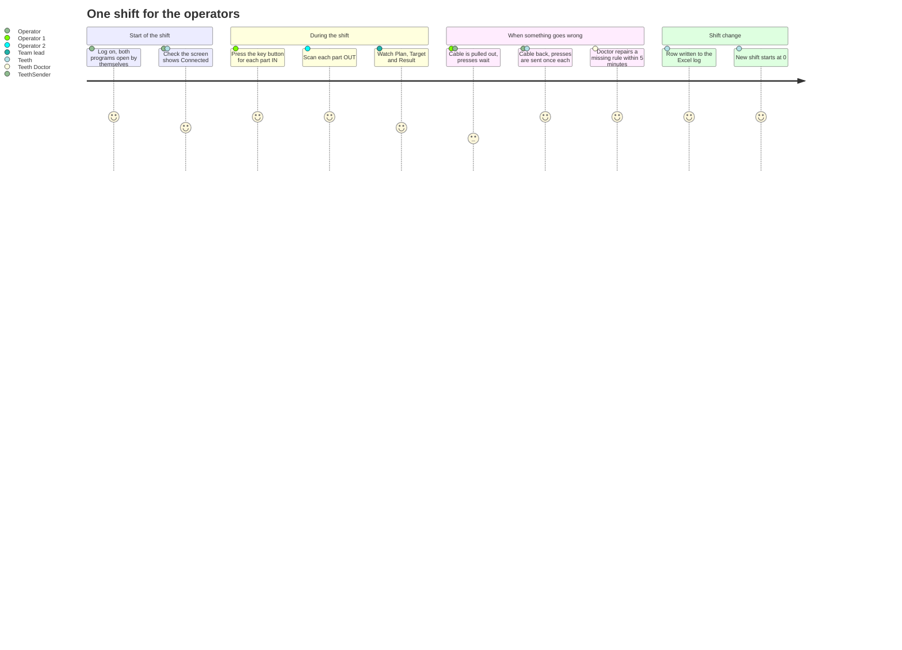

### Project timeline

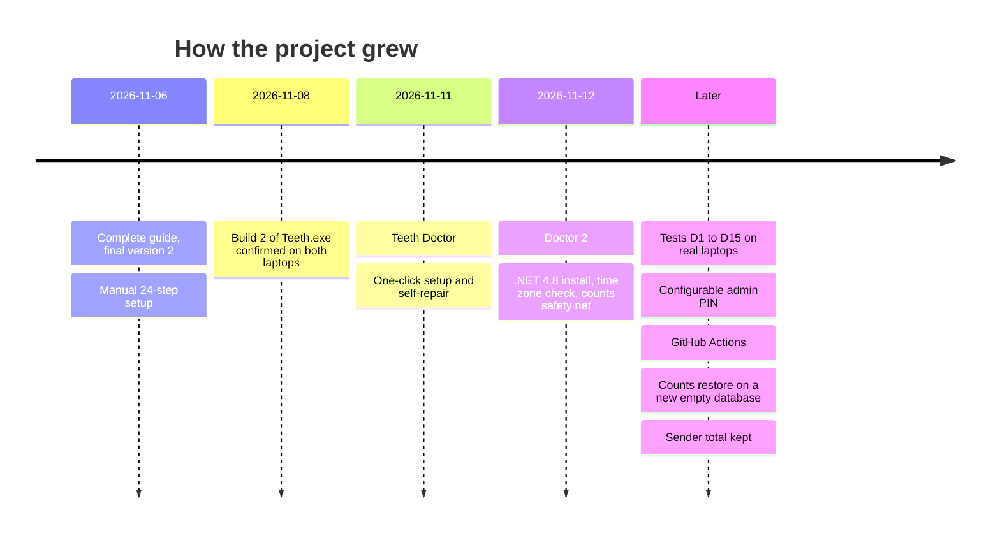

<p align="right">(<a href="#readme-top">back to top</a>)</p>

## Data model

Teeth keeps live data in a small **SQLite** file and history in an **Excel** workbook.

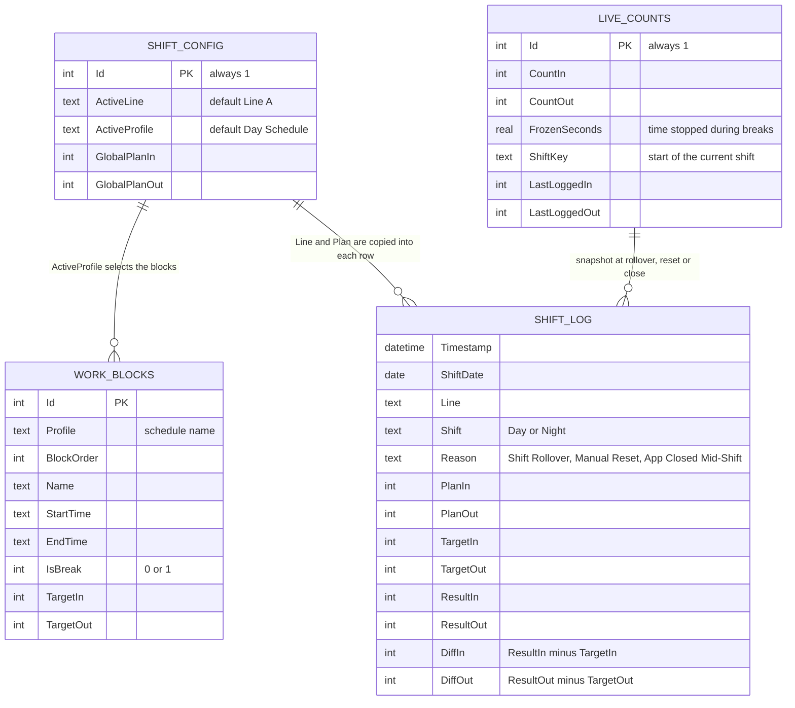

> `SHIFT_LOG` is the **Shift Log** sheet of `Log Data\Teeth_Log.xlsx`, not a database table.

<p align="right">(<a href="#readme-top">back to top</a>)</p>

## Requirements

| What | Needs |
|---|---|
| Laptops | 2 × Windows 10 or 11, **64-bit** |
| Framework | **.NET Framework 4.8** (an old PC with 4.7 gets it installed by `TEETH-AUTO.bat` after a *Yes*) |
| Hardware | 2 × USB-to-Ethernet adapters, 1 × Ethernet cable, a key button (sends `P` + `Enter`), a barcode scanner (types the code + `Enter`) |
| Rights | Administrator rights on both laptops for the first run |
| Not needed | Internet, router, switch, Visual Studio |

<p align="right">(<a href="#readme-top">back to top</a>)</p>

## Quick start

> **Always run the project from `C:\Teeth`.** Another copy of the folder has its own empty database.

1. **Download** this repository (green **Code** button, *Download ZIP*) or the latest release, and unzip it. If it contains another zip, unzip that one too. Never run from inside a zip.
2. **Copy the folder** to `C:\Teeth` on **both** laptops.
3. **Plug in** one USB-Ethernet adapter per laptop (always the same USB port) and the cable between the two adapters.
4. **Laptop 2 first:** double-click `App Files\Tools\Run-Doctor-SelfTest.bat` (it must say *ALL CHECKS PASSED*), then `TEETH-AUTO.bat`, click **Yes**, and type `2` the first time.
5. **Laptop 1 second:** the same, and type `1` the first time.
6. Read the last big line: 🟢 **GREEN** ready · 🟡 **YELLOW** works, read the `[NOTE]` lines · 🔴 **RED** a problem it cannot fix by itself (cable, adapter, IT policy, clock). Fix it and click again.

`TEETH-CHECK-ONLY.bat` only looks and changes nothing. `TEETH-UNDO.bat` removes what the automatic setup added.

Prefer to do it by hand? The **24 manual steps** are in [`START-HERE_Teeth_Quick_Visual_Guide.pdf`](START-HERE_Teeth_Quick_Visual_Guide.pdf) and are the proven fallback.

<p align="right">(<a href="#readme-top">back to top</a>)</p>

## Daily use

- Both programs start by themselves at log-on. Nothing to do.
- Press the **key button** for each part IN. **Scan** each part OUT.
- Missed a press? `Ctrl+Alt+I` (IN) or `Ctrl+Alt+O` (OUT) on Teeth adds one by hand.
- `Change Schedule` (or `Ctrl+Alt+S`) edits the line name, the plan and the work blocks.
- `Reset Result` zeroes the counts and writes a **Manual Reset** row to Excel.
- The bar on laptop 1 shows the running total of confirmed presses, and it is **kept across restarts** of TeethSender. The shift totals that count are on laptop 2 and in the Excel log.

<p align="right">(<a href="#readme-top">back to top</a>)</p>

## Configuration

Settings live in `App Files\` and are created with sensible defaults on first run. Lines starting with `#` are comments.

| File | Key | Default | Meaning |
|---|---|---|---|
| `link.ini` | `Port` | `5055` | TCP port Teeth listens on (the sender must match) |
| `link.ini` | `LinkTimeoutSeconds` | `6` | Silence before the screen shows *NOT connected* |
| `link.ini` | `ScanEnabled` | `true` | Count a scan as +1 OUT |
| `link.ini` | `ScanMinChars` | `4` | Minimum characters before `Enter` to count as a scan |
| `link.ini` | `ScanMaxGapMs` | `50` | Maximum gap between characters. Raise it for a slow scanner |
| `sender.ini` | `Host` | `192.168.50.2` | Where TeethSender sends the counts |
| `teeth-doctor.ini` | `RestartPrograms` | `true` | `false` stops the automatic restart of the programs |
| `teeth-doctor.ini` | `WatchEveryMinutes` | `5` | How often the Doctor checks |
| `teeth-doctor.ini` | `TimeZone` | `SE Asia Standard Time` | The time zone the shifts expect (the clock of laptop 2 drives the shifts) |

<p align="right">(<a href="#readme-top">back to top</a>)</p>

## Teeth Doctor: the self-repairing setup

`TEETH-AUTO.bat` runs `App Files\Tools\Teeth-Doctor.ps1`. The first click does the setup. It then creates the scheduled task **Teeth Doctor**, which repeats the check at every log-on and every 5 minutes, hidden, with no question and no focus stolen from the scanner.

| What goes wrong | What the Doctor does | What you do |
|---|---|---|
| USB adapter moved to another port, or its IP lost | Finds it by MAC address and sets `192.168.50.x` again | Nothing |
| Firewall rule deleted | Adds `Teeth link` and `Teeth ping` again (only from `192.168.50.0/24`, incoming only) | Nothing |
| `Teeth.exe` or `TeethSender.exe` closed | Starts it again | Nothing |
| `.NET 4.8` missing | Run by hand: asks once, installs it (checks the Microsoft signature) | Answer **Y**, restart, run again |
| Time zone differs from `TimeZone=` | Run by hand: asks, changes it, keeps the clock time | Answer **Y** |
| Counts come back as 0 / 0, or Teeth starts with a new empty database, in the same shift | Restores them from the backup in `C:\ProgramData\Teeth` | Nothing |
| Cable out, or the other laptop off | Reports **RED**. Presses wait in `pending.txt` | Plug the cable in |

**It never touches** the built-in Ethernet port, the print software, the printers, Wi-Fi, or the sleep settings (it only warns).

<div align="center">
  
</div>

Results are in `App Files\Logs\` (`LAST-STATUS.txt`, `Teeth-Doctor-log.txt`, `counts-history.txt`). Send `LAST-STATUS.txt` to the maintainer when something is red.

<p align="right">(<a href="#readme-top">back to top</a>)</p>

## Project structure

```text
Production-Plan/
├── TEETH-AUTO.bat                 one click: set up and repair this laptop
├── TEETH-CHECK-ONLY.bat           look and report, change nothing
├── TEETH-UNDO.bat                 remove the task, firewall rules, adapter address
├── Teeth.exe                      laptop 2: counts OUT, big screen, Excel log
├── TeethSender.exe                laptop 1: counts IN, sends to Teeth
├── Test-Link.bat                  quick link test
├── .github/workflows/             GitHub Actions: build both programs, run the Doctor tests
├── App Files/
│   ├── Tools/                     Teeth-Doctor.ps1, Run-Doctor-SelfTest.bat, firewall helpers
│   ├── Source/Teeth/              C# source of Teeth.exe
│   ├── Source_Sender/TeethSender/ C# source of TeethSender.exe
│   ├── Source_Build/              build script, link simulation, Doctor tests
│   ├── lib/                       SQLite and ClosedXML libraries
│   ├── Backup/                    earlier builds for roll-back
│   └── Logs/                      created at run time
├── Log Data/                      Teeth_Log.xlsx is created here
├── docs/                          full reference guide, plan, images
├── START-HERE_Teeth_Quick_Visual_Guide.pdf
├── Teeth_Troubleshooting_Guide.pdf
├── Teeth_Rollout_Kit.pdf
├── SETUP-TWO-LAPTOPS.txt · SENDER-HOW-TO.txt · VERSION.txt
├── assets/                        README banner, animations (SVG), images
├── CHANGELOG.md · CONTRIBUTING.md · CODE_OF_CONDUCT.md · SECURITY.md
└── LICENSE
```

<p align="right">(<a href="#readme-top">back to top</a>)</p>

## Build from source

Both programs are C# WinForms for **.NET Framework 4.8**.

- **Visual Studio 2019 or newer:** open `App Files\Source\Teeth\Teeth.csproj` and `App Files\Source_Sender\TeethSender\TeethSender.csproj`, set the configuration to **Release**, and build.
- **Command line:** `msbuild "App Files\Source\Teeth\Teeth.csproj" /p:Configuration=Release`
- **Linux / macOS:** `App Files/Source_Build/build-with-mono.sh` cross-builds with Mono.

Copy the built `.exe` next to `App Files` (the libraries come from `App Files\lib`).

### Built with

[C#](https://learn.microsoft.com/dotnet/csharp/) · [.NET Framework 4.8](https://dotnet.microsoft.com/download/dotnet-framework/net48) · [Windows Forms](https://learn.microsoft.com/dotnet/desktop/winforms/) · [System.Data.SQLite](https://system.data.sqlite.org/) · [ClosedXML](https://github.com/ClosedXML/ClosedXML) · [PowerShell 5.1](https://learn.microsoft.com/powershell/)

<p align="right">(<a href="#readme-top">back to top</a>)</p>

## Testing

The Doctor ships with its own test suites in `App Files\Source_Build\doctor-tests\`:

| Suite | Checks | What it proves |
|---|---:|---|
| `Test-Doctor-Static.ps1` | 35 | Files exist, ASCII and CRLF, parses, no PowerShell 7-only syntax (so it runs on Windows PowerShell 5.1), every command is a known one, the docs tell the same procedure |
| `Test-Doctor-Logic.ps1` | 42 | Decisions: ini parsing, MAC addresses, which USB adapter is safe to change, power settings, GREEN/YELLOW/RED, counts restore, shift keys |
| `Test-Doctor-Scenarios.ps1` | 36 | Simulated PCs: first setup, repair, cable out, .NET 4.7, wrong time zone, lost counts |
| **Total** | **113** | **All passing** (result file: `RESULT-2026-11-12.txt`) |

The acceptance tests **D1 to D15** (`docs\Teeth_Two_Laptop_Plan.md`) have been run on real laptops and the system is in use. To repeat them on a new pair, run `App Files\Tools\Run-Doctor-SelfTest.bat` (it changes nothing) first.

**Continuous integration:** on every push, GitHub Actions builds both programs and runs the three Doctor test suites.

<p align="right">(<a href="#readme-top">back to top</a>)</p>

## Troubleshooting

| You see | Do this |
|---|---|
| 🔴 RED *no cable signal* | Is laptop 2 on? Look at the lights on **both** adapters. Plug the cable into the USB adapters, not the built-in ports. Swap the cable, then the adapter, then the USB port. |
| 🔴 RED *no contact / Teeth not listening* | Start laptop 2 first, then run `TEETH-AUTO.bat` on laptop 1 again. |
| 🟡 *Time zone differs* | Run `TEETH-AUTO.bat` and answer **Y**. |
| *.NET Framework 4.8 not found* | Run `TEETH-AUTO.bat` by hand and answer **Y**, then restart. |
| *Counts went back to 0* | A shift change writes a **Shift Rollover** row and starts at 0 (normal). A manual **Reset Result** writes a **Manual Reset** row. Otherwise send `counts-history.txt` and `LAST-STATUS.txt`. |
| *Printing stopped* | The setup never changes the built-in port. See the troubleshooting guide, page 9. |

Full guide: [`Teeth_Troubleshooting_Guide.pdf`](Teeth_Troubleshooting_Guide.pdf).

<p align="right">(<a href="#readme-top">back to top</a>)</p>

## FAQ

<details>
<summary><b>Will it stop my label printing?</b></summary>

No. The Teeth link uses a **second** network port (a USB adapter) with its own private addresses. The built-in Ethernet port and the print software are never changed, and TeethSender and Teeth only *listen* to the keys, they never block them.
</details>

<details>
<summary><b>Do I need internet, a router or a server?</b></summary>

No. The two laptops are joined by one cable. The only time internet helps is to download the .NET Framework 4.8 installer on an old PC, and you can copy that file from a USB stick instead.
</details>

<details>
<summary><b>What happens if the cable is pulled out?</b></summary>

Nothing is lost. Each key press waits in `pending.txt` with a unique id and is sent again when the link is back. Laptop 2 counts each id once. See [No lost presses](#no-lost-presses).
</details>

<details>
<summary><b>What happens when a laptop restarts or crashes?</b></summary>

Both programs start by themselves at log-on. Teeth saves the counts to SQLite every 3 seconds and restores them in the same shift, and the Doctor keeps a second backup outside the Teeth folder.
</details>

<details>
<summary><b>Can I use it for more than one line?</b></summary>

Yes, with **one pair of laptops per line**. Each pair has its own cable, database and Excel log. One sender laptop per screen is supported; several senders for one screen is not. See [`Teeth_Rollout_Kit.pdf`](Teeth_Rollout_Kit.pdf).
</details>

<details>
<summary><b>Which shifts does it use, and can I change the schedule?</b></summary>

Day `08:00-20:00` and Night `20:00-08:00`. The line name, the plan and the work blocks (with breaks and targets) are edited with **Change Schedule**. The clock of laptop 2 drives the shifts, so keep its date, time and time zone correct.
</details>

<details>
<summary><b>How do I remove it?</b></summary>

Run `TEETH-UNDO.bat`. It removes the scheduled task, the two firewall rules and the adapter address. The programs, the database and the Excel log stay.
</details>

<p align="right">(<a href="#readme-top">back to top</a>)</p>

## Security

- The link is a **direct cable** on a private network (`192.168.50.0/24`, no gateway). The firewall rules the tool adds accept **incoming** connections only from that network, on TCP port `5055`.
- The programs need no internet and send no data anywhere.
- The admin PIN is a setting, not a value built into the program. Keep real PINs, `Teeth.sqlite` and the Excel logs out of the repository (the `.gitignore` excludes them).
- Found a vulnerability? Please follow [`SECURITY.md`](SECURITY.md) and do not open a public issue.

<p align="right">(<a href="#readme-top">back to top</a>)</p>

## Project status and limits

- ✅ **In use on real laptops.** The manual setup, the one-click `TEETH-AUTO.bat` and the Teeth Doctor passed the acceptance tests D1 to D15.
- ✅ **113 automatic checks** (35 static, 42 logic, 36 scenarios) pass, and GitHub Actions runs them on every push.
- ✅ **Counts survive** restarts, crashes, a new empty database in the same shift, and the sender's running total survives restarts.
- ⚠️ A manual `Reset Result` followed by a Teeth restart within 5 minutes can still bring the old counts back (reset again).
- Supported: **one sender laptop per Teeth**, one line per pair. Not supported: several senders for one screen, Windows older than 10, 32-bit Windows, Wi-Fi as the link.
- Each laptop pair is independent: its own cable, database, Excel log and firewall rules.

<p align="right">(<a href="#readme-top">back to top</a>)</p>

## Roadmap

- [x] IN / OUT counting with a private two-laptop link
- [x] Plan / Target / Result dashboard and Excel shift log
- [x] One-click setup and self-repair (Teeth Doctor)
- [x] Counts safety net on laptop 2
- [x] Acceptance tests D1 to D15 run on real laptops
- [x] Admin PIN is configurable instead of a built-in value
- [x] Real screenshots and a short screen recording
- [x] GitHub Actions: build both programs and run the Doctor test suites on every push
- [x] Restore counts even when Teeth starts with a new empty database
- [x] Keep the sender's running total across restarts
- [ ] Publish versioned releases (a zip per version on the Releases page)
- [ ] A daily summary sheet in the Excel log (all shifts of one day)

See the [open issues](https://github.com/ChornChhery/Production-Plan/issues) for proposals and known problems.

<p align="right">(<a href="#readme-top">back to top</a>)</p>

## Changelog

Every release is listed in [`CHANGELOG.md`](CHANGELOG.md) and on the [Releases page](https://github.com/ChornChhery/Production-Plan/releases).

<p align="right">(<a href="#readme-top">back to top</a>)</p>

## Documentation

| Document | For |
|---|---|
| [`START-HERE_Teeth_Quick_Visual_Guide.pdf`](START-HERE_Teeth_Quick_Visual_Guide.pdf) | The one-click workflow, flowcharts, and the 24 manual steps with pictures |
| [`docs/Teeth_Full_Reference_Guide.pdf`](docs/Teeth_Full_Reference_Guide.pdf) | Complete setup guide, parts A to F |
| [`Teeth_Troubleshooting_Guide.pdf`](Teeth_Troubleshooting_Guide.pdf) | Find a problem, follow the rows |
| [`Teeth_Rollout_Kit.pdf`](Teeth_Rollout_Kit.pdf) | Using it on more laptop pairs |
| [`docs/Teeth_Two_Laptop_Plan.md`](docs/Teeth_Two_Laptop_Plan.md) | Design, acceptance tests, maintainer notes |
| [`docs/AI_CONTEXT.md`](docs/AI_CONTEXT.md) | Background for anyone (or any AI helper) continuing the project |
| [`SETUP-TWO-LAPTOPS.txt`](SETUP-TWO-LAPTOPS.txt) · [`SENDER-HOW-TO.txt`](SENDER-HOW-TO.txt) | Plain-text setup notes |

<p align="right">(<a href="#readme-top">back to top</a>)</p>

## Contributing

Contributions make the project better for everyone. Any contribution is **appreciated**. Please read [`CONTRIBUTING.md`](CONTRIBUTING.md) and the [`CODE_OF_CONDUCT.md`](CODE_OF_CONDUCT.md) first.

1. Fork the project
2. Create a branch: `git checkout -b feature/my-improvement`
3. Run the Doctor tests (`App Files\Source_Build\doctor-tests`) if you touch `Teeth-Doctor.ps1`
4. Commit: `git commit -m "Add my improvement"`
5. Push: `git push origin feature/my-improvement`
6. Open a **Pull Request**

Never commit real production data (`Teeth.sqlite`, `Log Data\*.xlsx`, `pending.txt`); the `.gitignore` already excludes them.

### Contributors

<a href="https://github.com/ChornChhery/Production-Plan/graphs/contributors">
  
</a>

<p align="right">(<a href="#readme-top">back to top</a>)</p>

## License

Distributed under the **MIT License**. See [`LICENSE`](LICENSE) for the full text.

<p align="right">(<a href="#readme-top">back to top</a>)</p>

## Contact and acknowledgments

**Chorn Chhery** · [@ChornChhery](https://github.com/ChornChhery) · Project: <https://github.com/ChornChhery/Production-Plan>

- [System.Data.SQLite](https://system.data.sqlite.org/) and [ClosedXML](https://github.com/ClosedXML/ClosedXML) for storage and the Excel log
- [Mermaid](https://mermaid.js.org/) for the diagrams that GitHub renders natively
- [Shields.io](https://shields.io/) for the badges
- [Best-README-Template](https://github.com/othneildrew/Best-README-Template) and [Awesome README](https://github.com/matiassingers/awesome-readme) for README inspiration

<p align="right">(<a href="#readme-top">back to top</a>)</p>
